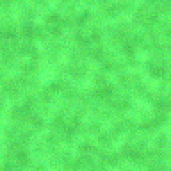
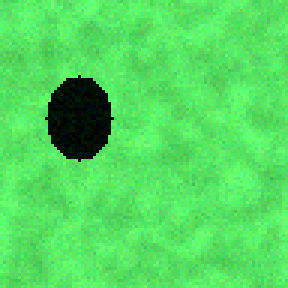
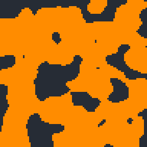
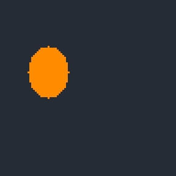
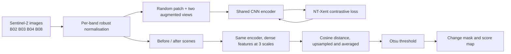

# Self-Supervised Satellite Change Detection

[](https://github.com/inshal8717/self-supervised-satellite-change-detection-train/actions/workflows/ci.yml)

**In plain words:** give it two satellite photos of the same place, taken months apart, and it marks the pixels that
changed, such as cleared forest, new buildings or flooding. Most systems like this need people to hand-label
thousands of "this changed" examples. This one first learns what satellite images look like from **unlabelled**
photos, then compares what its neural network "sees" in the two photos.

**Project page (pictures, results, glossary):** https://inshal8717.github.io/self-supervised-satellite-change-detection-train/

> **Status: a research project with an honest negative result.** On photos the network never saw, the trained network
> does not yet beat a simple colour difference. The cause is visible in the table below. Earlier figures in this
> repository (AUROC 0.98) were measured on the training scenes and are withdrawn.

## What it looks like

One held-out synthetic scene. Orange means "changed". The first two are the question, the third is the answer key,
and the rest are attempts at the answer.

| Before | After | What really changed | Trained network | Colour difference, raw |
| :---: | :---: | :---: | :---: | :---: |
|  |  |  |  |  |

The trained network marks most of the scene as changed. A plain colour difference on the raw values finds just the
changed patch.

## Results on held-out synthetic scenes

The network was pretrained on scenes 0–7 and scored on scenes 8–11, which it never saw. Every method uses the same
scenes and the same per-scene Otsu cut-off. Reproduce with `python scripts/reproduce_results.py`.

| Method | AUROC | F1 | IoU | Precision | Recall |
| --- | ---: | ---: | ---: | ---: | ---: |
| Trained network | 0.491 | 0.181 | 0.101 | 0.103 | 0.798 |
| Same network, untrained (random weights) | 0.702 | 0.529 | 0.449 | 0.477 | 0.673 |
| Colour difference, each photo stretched on its own | 0.740 | 0.240 | 0.138 | 0.144 | 0.757 |
| Colour difference, raw values | **1.000** | **1.000** | **1.000** | **1.000** | **1.000** |

How to read it: AUROC is a score from 0 to 1, where 0.5 is the same as guessing and 1.0 is perfect. F1 and IoU score
the final changed/unchanged map the same way. The page above has a glossary.

**Why the last two rows matter.** Before comparing, the code stretches each photo's brightness using that photo's own
percentiles (`normalize_reflectance`). A large change in one photo shifts its stretch, so the whole scene looks
different from the other photo. Without that stretch, a plain difference separates the change perfectly. The network
is trained on stretched photos as well, so it very likely suffers the same way. I have not retrained it with one
shared stretch for both dates, and that is the first thing to try.

The scenes are synthetic, with flat, distinct changed patches and mild noise, so even the perfect score does not
predict real-world accuracy. These numbers check that the pipeline runs and show how the methods compare.

## Architecture



The encoder is fully convolutional: a stem and three stride-2 stages with widths `32 → 64 → 128 → 256`. Feature
distances from all three stages are resized to the input size and averaged.

## Quick start

Requires Python 3.10 or newer. CPU is enough.

```bash
pip install -e ".[geo,test,lint,dashboard]"

# Smoke test: 2 epochs on 8 synthetic scenes, about a minute on CPU
python scripts/demo.py --synthetic

# Full held-out experiment and the project page data (a few minutes on CPU)
python scripts/reproduce_results.py
python scripts/build_site.py      # writes docs/index.html

# Interactive dashboard at http://localhost:8501
streamlit run app.py
```

Running `scripts/demo.py` on its own (without `--synthetic`) uses `data/real` when it holds image pairs and masks, and
generates synthetic data otherwise.

### Run change detection on your own pair

```bash
python -m sat_change.predict \
  --before before.tif --after after.tif \
  --checkpoint outputs/demo/best.pt \
  --output outputs/change.tif
```

This writes the score map, a binary mask (`change_mask.tif`), and a JSON summary. Use `--threshold` to set a fixed
threshold instead of Otsu.

## Data layout

Imagery is `C × H × W`, as `.npy` or `.tif`/`.tiff`. Images with the same scene key and different dates form a pair.
The scene key is the filename with its trailing date removed. Within a scene, the earliest and latest acquisitions form
the before/after pair. Anything inside a `masks/` folder is ground truth and is never used as imagery.

```text
data/real/
  vegas/
    images/vegas_2023-03-31.tif
    images/vegas_2023-09-07.tif
    masks/vegas.tif        # optional, for evaluation
```

Sentinel-2 L2A bands `B02, B03, B04, B08` at 10 m are the expected inputs. Reflectance can be `0..1` or Sentinel's
integer scale (`0..10000`).

## Real satellite data

`scripts/fetch_sentinel2.py` downloads Sentinel-2 L2A surface reflectance from Microsoft Planetary Computer. It needs
no account or API key, and it co-registers both dates onto one 10 m UTM grid. Install the extras first with
`pip install -e ".[fetch]"`.

```bash
python scripts/fetch_sentinel2.py \
  --center=-115.2,36.1 \
  --size 6 \
  --before 2023-01-01/2023-03-31 \
  --after 2023-08-01/2023-10-31 \
  --scene vegas \
  --output data/real \
  --cloud-max 25 \
  --limit 3 \
  --mask path/to/change_mask.tif
```

| Option | Meaning |
| --- | --- |
| `--center` | AOI centre as `lon,lat`. Use the `=` form for negative longitudes. |
| `--size` | AOI side length in km. |
| `--before`, `--after` | Acquisition windows as ISO date ranges. |
| `--scene` | Scene key used in all output filenames. |
| `--cloud-max` | Maximum scene-level cloud cover for candidate acquisitions. |
| `--limit` | Acquisitions to median-composite per window. Clouds, shadows and nodata are excluded (SCL mask). |
| `--mask` | Optional ground-truth change mask (GeoTIFF), written for evaluation. |

Without a mask you can still inspect the score maps, but IoU, F1 and AUROC are not computed.

To export the same inputs from Google Earth Engine instead, filter `COPERNICUS/S2_SR_HARMONIZED` by area, date and
cloud cover, mask clouds, make one composite per window, reproject both to the same grid, and name the files with the
scene key and window date.

## Methodology

Two augmented views of the same patch are positives. All other samples in the batch are negatives. Pretraining never
sees before/after pairs, so it learns from single images. Augmentations are flips, rotations, mild gain and bias
jitter, noise and blur, which keep spatial structure. At inference, normalised features for the two dates are compared
with cosine distance at three scales. The scales are upsampled and averaged, and Otsu thresholding gives a
label-free mask.

**Evaluation caveats:** the held-out split is by scene, not by patch, which avoids spatial leakage. Each scene's
threshold is chosen by Otsu on that scene's own scores, so no label is used. Thresholds fitted on a separate validation
region would be more honest for deployment. Report precision-recall curves as well as F1, because changed pixels are
rare.

## Engineering trade-offs

- **Small CNN instead of a large pretrained backbone:** it trains on a CPU and keeps dense feature stages. A larger
  model might transfer better, at the cost of compute and pretrained-weight assumptions.
- **Self-supervised instead of supervised:** no annotation is needed. The price is a threshold-sensitive anomaly score,
  not a calibrated class probability.
- **Tiled inference with overlap:** the network runs tile by tile, which bounds memory per forward pass. Both input
  scenes are still loaded in full, and overlap adds runtime.
- **Per-image normalisation:** each date is normalised by its own percentiles. That is simple, but a change in scene
  composition shifts that date's scale, so it creates false change. On the held-out scenes this cut a plain
  difference's AUROC from 1.00 to 0.74 (see Results), so it is the leading suspect for the trained network's failure.
- **AdamW with cosine decay:** a stable default for contrastive training. It is not tuned for any particular biome.

## Limitations

This is a research baseline, not an operational product.

- On held-out synthetic scenes it does not beat a simple spectral difference (see Results).
- It has not been evaluated on real labelled change data. Public benchmarks with trusted masks are the necessary next step.
- The model outputs a binary change mask. It does not identify the type of change.
- Inputs must already be co-registered at pixel level. Misalignment produces false positives.
- `sat_change.train` does not read manifests or splits. The held-out split is set up by `scripts/reproduce_results.py`.
- `best.pt` is the checkpoint with the lowest training loss. There is no validation set, so it is not chosen on held-out data.
- Pretraining uses every image under the data root, including scenes you later evaluate on, unless you split them
  as the reproduction script does.

Next steps, in order of value:

1. Normalise the before and after photos with one shared stretch, then retrain and re-score. This directly tests the
   leading explanation for the negative result.
2. Test on real labelled change data (for example, public building or deforestation masks).
3. Compare against more baselines: NDVI/NDBI/NDWI differences, and a small supervised U-Net trained on the same scenes.
4. Tune the pretraining budget and the number of scenes, and check whether the random-encoder result depends on the architecture.
5. Calibrate the threshold on a validation region, and report precision-recall curves.

## Tests and lint

```bash
pip install -e ".[geo,test,lint,dashboard]"
ruff check .
python -m pytest -q
```

CI runs both on every push and pull request, on Python 3.10 and 3.12 (`.github/workflows/ci.yml`). The suite has 31
tests, including an end-to-end run on tiny synthetic data that finishes in a few seconds on a CPU, and checks that
the project page builds, loads no scripts, and matches the committed results.

## Dashboard

`streamlit run app.py` lets you choose a checkpoint from `outputs/`, upload a before/after pair (`.npy` or GeoTIFF),
and optionally upload a mask. It shows the inputs, the dense change heatmap, the binary mask, the threshold and the
changed fraction. With a mask, it also shows IoU, F1, precision, recall and AUROC. GeoTIFF inputs with CRS metadata
get a map of changed pixels and GeoTIFF downloads. The dashboard runs locally only, and is not hosted.

## Project layout

```text
src/sat_change/     library: io, data, model, train, runtime, metrics, predict, evaluate
scripts/            synthetic data, demo, Sentinel-2 fetch, held-out reproduction, example images, project page builder
app.py              Streamlit dashboard
docs/               static project page (GitHub Pages)
tests/              unit tests and an end-to-end smoke test
```

## License

See `LICENSE`.
